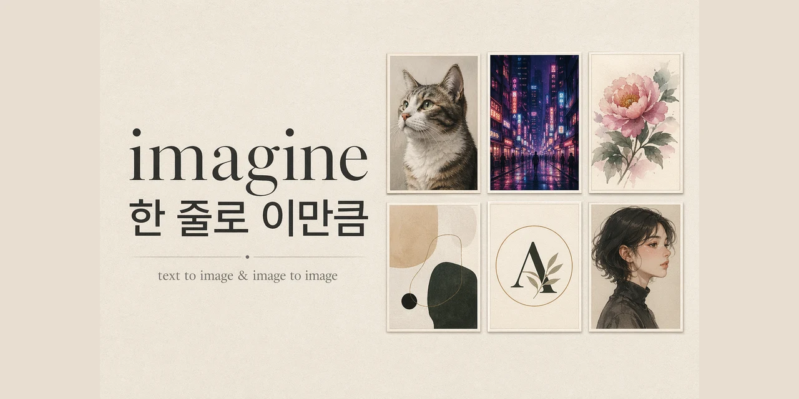

<div align="center">



# 🎨 imagine

### **"OpenAI API 키? 안 씁니다. ChatGPT 구독으로 끝."**

**Claude Code 안에서 `imagine ...` 한 줄이면 이미지가 튀어나옵니다.**

[](https://github.com/Mineru98/imagine)
[](./LICENSE)
[](https://docs.claude.com/claude-code)
[](https://nodejs.org)

</div>

---

## 🔥 왜 이게 화제냐면

> **매달 ChatGPT Plus $20 내고 있잖아요. 그거 이미 내고 있는데 왜 OpenAI Image API 크레딧을 또 삽니까?**

`imagine`은 여러분이 **이미 결제하고 있는 ChatGPT Plus/Pro 세션**을 재사용해서, Claude Code 안에서 구독 사용량 범위의 이미지를 생성합니다.

- 🔐 **API 키를 요구하지 않음** — v2부터 공식 Codex CLI(`codex exec`)의 내장 `image_gen` 도구를 ChatGPT 로그인 그대로 씁니다. 서드파티 프록시가 없습니다.
- 🤖 **Claude Code × ChatGPT 합법 동거** — Claude로 코딩하다가 `"imagine 사이버펑크 도시 3장"` 한 마디면 `./images/` 에 결과물이 착.
- 🎯 **"imagine"이라고만 말하면 끝** — 프롬프트 엔지니어링 몰라도 스킬이 알아서 size / quality / n 을 매핑합니다.
- 🖼️ **text→image 도 되고, image→image 리스타일도 됩니다** — 가지고 있던 사진을 수채화로, 로고를 네온 사인으로.
- 📦 **결과물은 프로젝트 안에** — 기본적으로 `./images/imagine_<timestamp>_<index>.png` 로 저장합니다. 입력 이미지는 모델 기반 편집 시 설정된 생성 서비스로 전송됩니다.

> 이 프로젝트는 [ktkarchive/codex-imagegen-2-skill-for-kimi](https://github.com/ktkarchive/codex-imagegen-2-skill-for-kimi) (Kimi CLI용) 을 참고하여 **Claude Code 플러그인 포맷**으로 재구성한 포크입니다. 원작자분께 리스펙트 🙏

---

## ⚡ 30초 설치

### 1. Claude Code 마켓플레이스에서 플러그인 설치

```bash
# Claude Code 마켓플레이스에서 설치
/plugin marketplace add Mineru98/imagine
/plugin install imagine
```

끝입니다. 정말로. 두 줄.

### 2. Codex CLI 설치 + ChatGPT 로그인 (최초 1회)

```bash
npm install -g @openai/codex@latest
codex login
```

브라우저가 열리면 평소 쓰는 ChatGPT 계정으로 로그인하세요. `codex login status` 가 `Logged in using ChatGPT` 이면 준비 끝입니다.

### 3. 요구사항

| 항목 | 요구 버전 / 조건 |
|------|------------------|
| **Node.js** | ≥ 18 |
| **Codex CLI** | `image_generation` 기능이 stable 인 최신 버전 (0.162 이상에서 확인) |
| **ChatGPT 구독** | Plus 또는 Pro (이미지 쿼터가 붙어 있는 플랜) |

> **v1 → v2 변경점**: v1 은 `npx openai-oauth` 로컬 프록시로 Responses API 를 직접 불렀지만, 최신 Codex 백엔드에서
> `tool_choice: "required"` 요청이 400 으로 거부되어 이미지가 나오지 않았습니다. v2 는 프록시를 걷어 내고
> `codex exec` 가 내장 `image_gen` 도구를 한 번 호출하게 한 뒤, `~/.codex/generated_images/<thread_id>/` 에 저장된 결과를
> 프로젝트로 복사합니다. `IMAGINE_ENABLE_LEGACY_PROXY` 는 더 이상 쓰지 않습니다.

---

## 🎬 써먹는 법

Claude Code 세션 안에서 그냥 자연어로 말해보세요.

```
/imagine 미래도시의 야경, 네온 반사가 번쩍이는 젖은 거리, 3장 뽑아줘
```

```
/imagine 이 사진(./me.png)을 유화 스타일로 바꿔서 저장해줘
```

스킬이 자동으로:
- 프롬프트 → `--prompt`
- "3장" → `--n 3`
- "고퀄" / "detailed" → `--quality high`
- "세로 포스터" → `--size 1024x1536`

이렇게 매핑해서 스크립트를 돌립니다.

### 스크립트를 직접 실행할 때

API 키나 `auth.json` 을 읽지 않고, 실행 중에는 `OPENAI_API_KEY` 를 자식 프로세스에서 지워
구독 대신 API 과금으로 넘어가는 일을 막습니다.

```bash
# text → image
node <skill-root>/scripts/generate.js \
  --prompt "a cyberpunk city at night, neon reflections on wet streets" \
  --quality high \
  --size 1024x1024 \
  --n 2

# image → image (리스타일)
node <skill-root>/scripts/edit.js \
  --input ./photo.png \
  --prompt "turn into a watercolor painting, soft pastels" \
  --out ./images/photo-watercolor.png
```

`--size` 와 `--quality` 는 내장 도구에 비율·품질 지시로 전달됩니다. 실제 픽셀 크기는 모델이 정하며(예: 1:1 → 1254×1254),
저장 후 검증 단계에서 출력합니다. Codex 실행 파일 경로를 바꾸려면 `IMAGINE_CODEX_BIN` 을 지정하세요.

---

## 🧩 `imagine` 만 있는 게 아닙니다 — 8개 스킬 · 10개 에이전트

이 플러그인에는 용도별로 특화된 **스킬 8개**와, 그 뒤에서 특정 역할만 맡는 **에이전트 10개**가 같이 들어 있습니다. 전체 지도·사용 순서·금기는 [`docs/skills-and-agents.md`](./docs/skills-and-agents.md) 한 장으로 정리해뒀습니다.

빠른 요약:

| 쓰임새 | 스킬 |
|---|---|
| 일반 텍스트→이미지 / 이미지→이미지 | [`imagine`](./skills/imagine/SKILL.md) |
| 디자인 스크린샷 → HTML+Tailwind | [`image-to-code`](./skills/image-to-code/SKILL.md) |
| 랜딩 히어로 3:2 | [`imagine-hero`](./skills/imagine-hero/SKILL.md) |
| 발표 섹션 일러스트 세트 | [`imagine-slide`](./skills/imagine-slide/SKILL.md) |
| OG·소셜 카드 (+ `--bulk`) | [`imagine-og`](./skills/imagine-og/SKILL.md) |
| 로고 시안 (마크 + 워드마크 + SVG) | [`imagine-logo`](./skills/imagine-logo/SKILL.md) |
| iOS·Android·Web 아이콘 세트 | [`imagine-icon`](./skills/imagine-icon/SKILL.md) |
| UI 무드 보드 레퍼런스 | [`imagine-ui`](./skills/imagine-ui/SKILL.md) |

그리고 뒤에서 같이 움직이는 에이전트들:

- 프롬프트/스타일 보정: [`prompt-director`](./agents/prompt-director.md) · [`style-guardian`](./agents/style-guardian.md) · [`visual-critic`](./agents/visual-critic.md)
- `image-to-code` 파이프라인: [`vision-analyst`](./agents/vision-analyst.md) → [`layout-architect`](./agents/layout-architect.md) · [`design-token-extractor`](./agents/design-token-extractor.md) · [`asset-extractor`](./agents/asset-extractor.md) · [`a11y-advisor`](./agents/a11y-advisor.md) → [`code-generator`](./agents/code-generator.md) → [`visual-verifier`](./agents/visual-verifier.md)

각 스킬의 트리거 키워드·출력 경로·금기 규칙은 [`docs/skills-and-agents.md`](./docs/skills-and-agents.md) 참고.

---

## ⚙️ 조정 가능한 기본값

`skills/imagine/config.json` 을 고치면 전역 기본값이 바뀝니다.

```json
{
  "default_quality": "medium",
  "default_size": "1024x1536",
  "default_format": "png",
  "output_dir": "./images"
}
```

| 키 | 허용 값 |
|----|---------|
| `default_quality` | `low` \| `medium` \| `high` |
| `default_size` | `1024x1024` (1:1) \| `1024x1536` (2:3) \| `1536x1024` (3:2) |
| `default_format` | `png` (현재 runner는 PNG bytes만 검증) |
| `output_dir` | 아무 경로 (절대경로면 글로벌 수집함으로 사용 가능) |

---

## 🧠 동작 원리 (궁금한 분만)

```
Claude Code
    ↓ "imagine ..." 스킬 트리거
generate.js / edit.js
    ↓ codex login status (준비 확인)
codex exec --json --sandbox read-only -   ← 지시문은 stdin, 편집 대상은 --image
    ↓ 내장 image_gen 1회 호출 (셸·파일 접근 금지 지시)
~/.codex/generated_images/<thread_id>/*.png
    ↓ 복사
./images/imagine_<ts>_<i>.png  ← 저장 + PNG 무결성 검증
```

`--n` 은 이미지마다 별도 Codex 세션을 열어 최대 2개씩 병렬로 돌립니다.

---

## 🧯 트러블슈팅

| 증상 | 해결 |
|------|------|
| `Codex CLI is not ready` | `npm install -g @openai/codex@latest` 후 `codex login` |
| `Codex finished without producing an image` | 모델이 도구를 부르지 않았거나 거부함 — 프롬프트를 단순하게 바꿔 한 번 재시도 |
| `Codex did not finish within 300s` | 네트워크·한도 지연 — 잠시 후 재시도 |
| `Rate limit` | ChatGPT 티어 한도 초과 — 몇 분 쉬고 `--n` 줄이기 |

더 자세한 내용은 [`skills/imagine/reference/installation.md`](./skills/imagine/reference/installation.md) 참고.

---

## 📜 License

MIT © [Mineru](https://github.com/Mineru98)

---

<div align="center">

**⭐ 도움이 됐다면 [레포지토리에 스타 한번만](https://github.com/Mineru98/imagine) 눌러주세요.**

**Claude로 코딩 → `imagine` 한 줄 → 썸네일까지 뽑기. 워크플로우가 끊기지 않습니다.**

</div>
